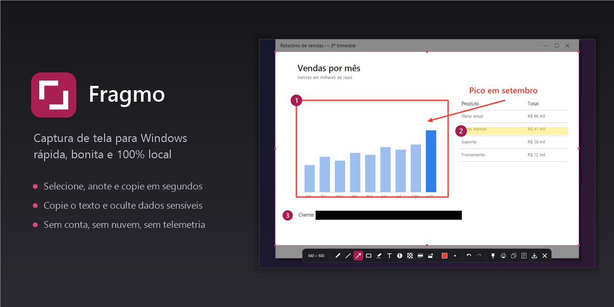
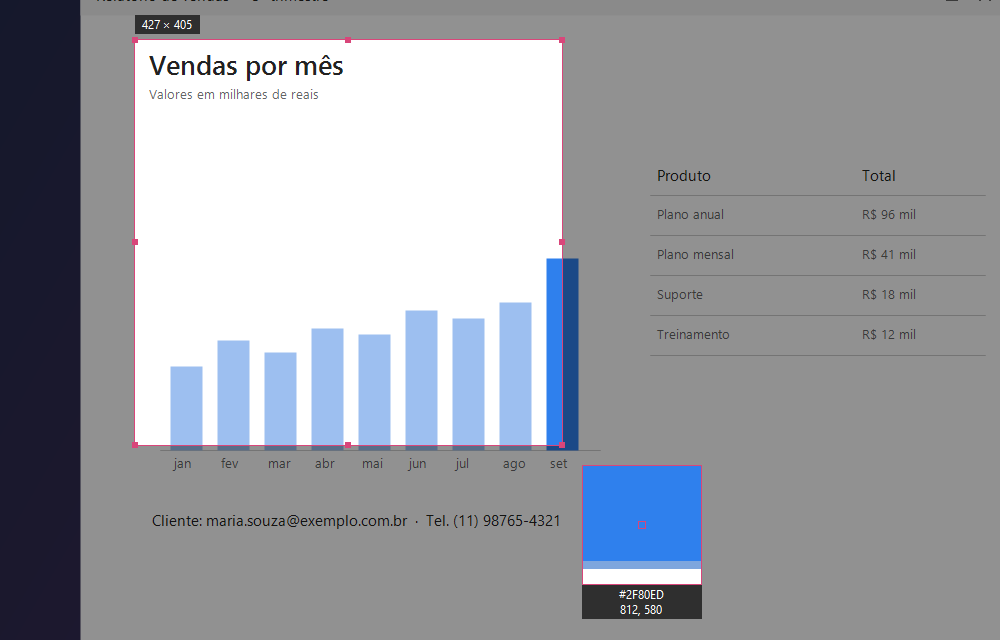
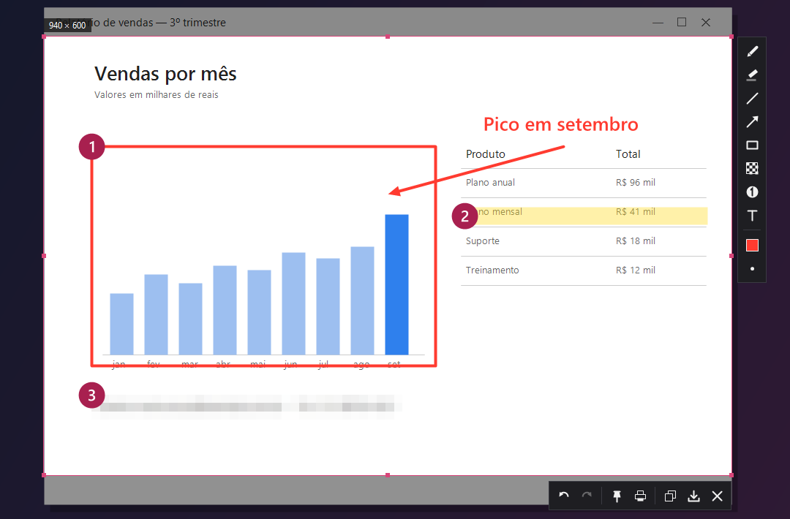
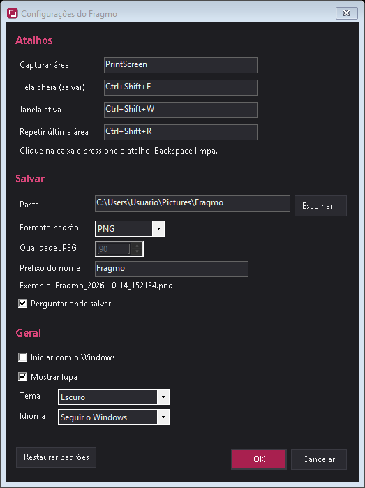

<p align="center">
  
</p>

<p align="center">
  <a href="https://github.com/brunokdalcastel/fragmo/releases/latest/download/Fragmo-Setup.exe"></a>
</p>

<p align="center">
  <a href="https://github.com/brunokdalcastel/fragmo/releases/latest"></a>
  
  <a href="LICENSE"></a>
</p>

<p align="center"><b>Português</b> · <a href="#english">English</a></p>

---

## Português

O **Fragmo** é um app de captura de tela para Windows. Aperte **Print Screen**, selecione a área, anote se quiser
e copie ou salve. Ele fica quietinho na bandeja, abre na hora e **tudo fica no seu computador**: sem conta, sem
nuvem, sem telemetria.

### Instalar (1 minuto)

1. **[Baixe o instalador](https://github.com/brunokdalcastel/fragmo/releases/latest/download/Fragmo-Setup.exe)** (`Fragmo-Setup.exe`).
2. Abra o arquivo baixado, escolha as opções (já vêm marcadas) e clique em **Instalar** e depois **Concluir**.
3. Pronto: o ícone do Fragmo aparece na bandeja, perto do relógio. Aperte **Print Screen** para capturar.

Não precisa de administrador nem do .NET. Por padrão o Fragmo já inicia junto com o Windows.

> **"O Windows protegeu o computador"?** O instalador ainda não tem assinatura digital (um certificado pago), então o
> SmartScreen avisa na primeira vez. Clique em **Mais informações › Executar assim mesmo**.

<details>
<summary><b>Prefere sem instalar? Versão portátil</b></summary>

Baixe o [`Fragmo.exe`](https://github.com/brunokdalcastel/fragmo/releases/latest/download/Fragmo.exe), coloque
numa pasta qualquer e abra. Para iniciar com o Windows, ligue a opção em **Configurações** (menu da bandeja).

</details>

### Como funciona

**1. Selecione.** Aperte Print Screen: a tela congela e você arrasta para escolher a área. A lupa mostra cada pixel e
a cor sob o cursor, e o tamanho da seleção aparece no canto.

<p align="center"></p>

**2. Anote.** Ao soltar o mouse, as barras de ferramentas aparecem ao lado da seleção. Destaque com retângulo, seta e
marcador, escreva um texto, numere os passos e **desfoque** dados sensíveis (o desfoque é gravado na imagem, não dá
para desfazer depois de salvar).

<p align="center"></p>

**3. Use.** Copie (`Ctrl+C` ou `Enter`) e cole onde quiser, salve em PNG/JPEG/BMP (`Ctrl+S`), imprima (`Ctrl+P`) ou
**fixe na tela** (`Ctrl+T`) para usar como referência por cima das outras janelas.

| Ferramenta | Tecla | | Ação | Atalho |
|---|---|---|---|---|
| Caneta | `P` | | Copiar | `Ctrl+C` / `Enter` |
| Linha | `L` | | Salvar | `Ctrl+S` |
| Seta | `A` | | Fixar na tela | `Ctrl+T` |
| Retângulo | `R` | | Imprimir | `Ctrl+P` |
| Texto | `T` | | Desfazer / refazer | `Ctrl+Z` / `Ctrl+Y` |
| Marcador | `M` | | Fechar | `Esc` |
| Desfoque | `B` | | | |
| Passos numerados | `N` | | | |

### Atalhos globais

| Ação | Atalho padrão |
|---|---|
| Capturar área | `Print Screen` (alternativo: `Ctrl+Shift+S`) |
| Tela cheia → salva direto na pasta | `Ctrl+Shift+F` |
| Janela ativa → abre no editor | `Ctrl+Shift+W` |
| Repetir a última área | `Ctrl+Shift+R` |

### Configurações

Clique com o botão direito no ícone da bandeja › **Configurações…**. Os atalhos mudam na hora (clique na caixa e
pressione a combinação), e você escolhe a pasta, o formato, o prefixo do nome, o tema e o idioma.

<p align="center"></p>

**A tecla Print Screen abre a ferramenta do Windows?** No Windows 11 ela vem reservada para a captura do próprio
sistema; nesse caso o Fragmo usa `Ctrl+Shift+S` e avisa na bandeja. Para liberar a tecla:
**Configurações do Windows › Acessibilidade › Teclado** › desative *"Usar a tecla Print Screen para abrir a captura
de tela"*. Depois feche o Fragmo (bandeja › Sair) e abra de novo.

### Atualizar e desinstalar

- **Atualizar:** baixe e rode o instalador mais novo; ele fecha o Fragmo, troca a versão e mantém suas configurações.
- **Desinstalar:** **Configurações do Windows › Apps › Apps instalados › Fragmo › Desinstalar**. As configurações
  ficam em `%APPDATA%\Fragmo`, caso queira apagá-las também.

### Privacidade

O Fragmo não acessa a rede e não tem telemetria. As capturas ficam em `%USERPROFILE%\Pictures\Fragmo` (ou na
pasta que você escolher) e as configurações em `%APPDATA%\Fragmo`.

### Desenvolvimento

Pré-requisitos: [.NET 10 SDK](https://dotnet.microsoft.com/download) e, para gerar o instalador,
[Inno Setup 6](https://jrsoftware.org/isinfo.php) (`winget install JRSoftware.InnoSetup`).

```powershell
dotnet build
dotnet test
dotnet run --project src/Fragmo
./publish.ps1   # testes + artifacts/publish/Fragmo.exe + artifacts/Fragmo-Setup.exe
```

---

## English

**Fragmo** is a screen capture app for Windows. Press **Print Screen**, select an area, annotate it if you like,
then copy or save. It sits quietly in the tray, opens instantly and **everything stays on your computer**: no account,
no cloud, no telemetry. The interface is available in English and Portuguese.

### Install (1 minute)

1. **[Download the installer](https://github.com/brunokdalcastel/fragmo/releases/latest/download/Fragmo-Setup.exe)** (`Fragmo-Setup.exe`).
2. Open the downloaded file, review the options (already checked) and click **Install**, then **Finish**.
3. Done: the Fragmo icon shows up in the tray, next to the clock. Press **Print Screen** to capture.

No admin rights and no .NET needed. By default Fragmo starts with Windows.

> **"Windows protected your PC"?** The installer is not code-signed yet (that requires a paid certificate), so
> SmartScreen warns on first run. Click **More info › Run anyway**.

<details>
<summary><b>Rather not install? Portable version</b></summary>

Download [`Fragmo.exe`](https://github.com/brunokdalcastel/fragmo/releases/latest/download/Fragmo.exe), put it
in any folder and run it. To start it with Windows, turn the option on in **Settings** (tray menu).

</details>

### How it works

**1. Select.** Press Print Screen: the screen freezes and you drag to pick the area. The magnifier shows every pixel
and the color under the cursor, and the selection size is shown in the corner.

<p align="center"></p>

**2. Annotate.** When you release the mouse, the toolbars appear next to the selection. Highlight with rectangles,
arrows and the highlighter, add text, number the steps and **blur** sensitive data (the blur is baked into the image).

<p align="center"></p>

**3. Use it.** Copy (`Ctrl+C` or `Enter`) and paste anywhere, save as PNG/JPEG/BMP (`Ctrl+S`), print (`Ctrl+P`) or
**pin it to the screen** (`Ctrl+T`) as an always-on-top reference.

| Tool | Key | | Action | Shortcut |
|---|---|---|---|---|
| Pen | `P` | | Copy | `Ctrl+C` / `Enter` |
| Line | `L` | | Save | `Ctrl+S` |
| Arrow | `A` | | Pin to screen | `Ctrl+T` |
| Rectangle | `R` | | Print | `Ctrl+P` |
| Text | `T` | | Undo / redo | `Ctrl+Z` / `Ctrl+Y` |
| Highlighter | `M` | | Close | `Esc` |
| Blur | `B` | | | |
| Numbered steps | `N` | | | |

### Global hotkeys

| Action | Default hotkey |
|---|---|
| Capture area | `Print Screen` (fallback: `Ctrl+Shift+S`) |
| Full screen → saved straight to the folder | `Ctrl+Shift+F` |
| Active window → opens in the editor | `Ctrl+Shift+W` |
| Repeat last area | `Ctrl+Shift+R` |

### Settings

Right-click the tray icon › **Settings…**. Hotkeys change immediately (click a box and press the combination), and you
can pick the folder, format, file name prefix, theme and language.

**Print Screen opens the Windows tool instead?** On Windows 11 the key is reserved for the built-in snipping tool; in
that case Fragmo uses `Ctrl+Shift+S` and shows a tray notice. To free the key: **Windows Settings › Accessibility ›
Keyboard** › turn off *"Use the Print screen key to open screen capture"*. Then exit Fragmo (tray › Exit) and start
it again.

### Update and uninstall

- **Update:** download and run the newest installer; it closes Fragmo, replaces it and keeps your settings.
- **Uninstall:** **Windows Settings › Apps › Installed apps › Fragmo › Uninstall**. Settings live in
  `%APPDATA%\Fragmo` if you want to delete them too.

### Privacy

Fragmo never touches the network and has no telemetry. Captures go to `%USERPROFILE%\Pictures\Fragmo` (or the
folder you choose) and settings to `%APPDATA%\Fragmo`.

### Development

Requirements: [.NET 10 SDK](https://dotnet.microsoft.com/download) and, to build the installer,
[Inno Setup 6](https://jrsoftware.org/isinfo.php) (`winget install JRSoftware.InnoSetup`).

```powershell
dotnet build
dotnet test
dotnet run --project src/Fragmo
./publish.ps1   # tests + artifacts/publish/Fragmo.exe + artifacts/Fragmo-Setup.exe
```

---

## Licença / License

[MIT](LICENSE) © 2026 Bruno K. Dal Castel
