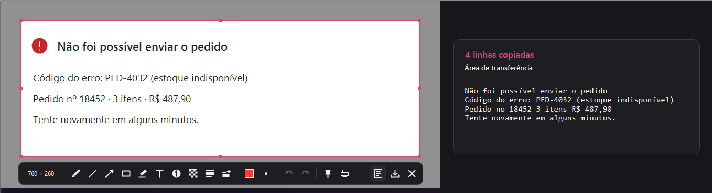
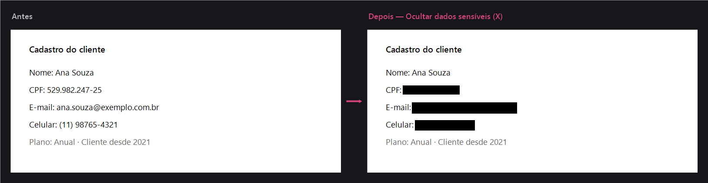

<p align="center">
  
</p>

<p align="center">
  <a href="https://github.com/brunokdalcastel/fragmo/releases/latest/download/Fragmo-Setup.exe"></a>
</p>

<p align="center">
  <a href="https://github.com/brunokdalcastel/fragmo/releases/latest"></a>
  
  <a href="LICENSE"></a>
</p>

<p align="center"><b>Português</b> · <a href="#english">English</a></p>

---

## Português

O **Fragmo** é um app de captura de tela para Windows. Aperte **Print Screen**, selecione a área, anote se quiser
e copie ou salve. Ele fica quietinho na bandeja, abre na hora e **tudo fica no seu computador**: sem conta, sem
nuvem, sem telemetria.

### Instalar (1 minuto)

1. **[Baixe o instalador](https://github.com/brunokdalcastel/fragmo/releases/latest/download/Fragmo-Setup.exe)** (`Fragmo-Setup.exe`).
2. Abra o arquivo baixado, escolha as opções (já vêm marcadas) e clique em **Instalar** e depois **Concluir**.
3. Pronto: o ícone do Fragmo aparece na bandeja, perto do relógio. Aperte **Print Screen** para capturar.

Não precisa de administrador nem do .NET. Por padrão o Fragmo já inicia junto com o Windows.

> **"O Windows protegeu o computador"?** O instalador ainda não tem assinatura digital (um certificado pago), então o
> SmartScreen avisa na primeira vez. Clique em **Mais informações › Executar assim mesmo**.

<details>
<summary><b>Prefere sem instalar? Versão portátil</b></summary>

Baixe o [`Fragmo.exe`](https://github.com/brunokdalcastel/fragmo/releases/latest/download/Fragmo.exe), coloque
numa pasta qualquer e abra. Para iniciar com o Windows, ligue a opção em **Configurações** (menu da bandeja).

</details>

### Como funciona

**1. Selecione.** Aperte Print Screen: a tela congela e você arrasta para escolher a área. A lupa mostra cada pixel e
a cor sob o cursor, e o tamanho da seleção aparece enquanto você arrasta.

<p align="center"></p>

**2. Anote.** Ao soltar o mouse, aparece **uma barra só**, centralizada abaixo da seleção, com o tamanho da área no
começo e as ferramentas em grupos. Destaque com retângulo, seta e marcador, escreva um texto, numere os passos e
esconda dados sensíveis com a **tarja opaca**, à mão ou com [ocultar dados sensíveis](#ocultar-dados-sensíveis).

<p align="center"></p>

**3. Use.** Copie a imagem (`Ctrl+C` ou `Enter`) e cole onde quiser, **copie o texto** que está na imagem (`O`), salve
em PNG/JPEG/BMP (`Ctrl+S`), imprima (`Ctrl+P`) ou **fixe na tela** (`Ctrl+T`) para usar como referência por cima das
outras janelas.

| Ferramenta | Tecla | | Ação | Atalho |
|---|---|---|---|---|
| Caneta | `P` | | Copiar imagem | `Ctrl+C` / `Enter` |
| Linha | `L` | | Copiar texto | `O` |
| Seta | `A` | | Salvar | `Ctrl+S` |
| Retângulo | `R` | | Fixar na tela | `Ctrl+T` |
| Marcador | `M` | | Imprimir | `Ctrl+P` |
| Texto | `T` | | Desfazer / refazer | `Ctrl+Z` / `Ctrl+Y` |
| Passos numerados | `N` | | Fechar | `Esc` |
| Desfoque (efeito visual) | `B` | | | |
| Tarja opaca | `H` | | | |
| Ocultar dados sensíveis | `X` | | | |

### Copiar texto da imagem

O botão **Copiar texto** (`O`) lê o texto da área selecionada e copia para a área de transferência, pronto para colar.
Serve para erros na tela, trechos de PDF protegido, legendas de vídeo, tabelas em imagem. O reconhecimento usa o OCR
do próprio Windows, no idioma do seu perfil, e roda no computador: nada é enviado para a internet.

Se aparecer o aviso de que falta o idioma, instale o pacote em **Configurações do Windows › Hora e idioma › Idioma e
região › "…" ao lado do idioma › Opções de idioma › Reconhecimento óptico de caracteres › Baixar**.

<p align="center"></p>

### Ocultar dados sensíveis

A **tarja opaca** (`H`) cobre a área com um retângulo preto sólido, gravado na imagem exportada. Ela não guarda nada do
que estava embaixo, por isso é a forma certa de esconder senhas, documentos e dados pessoais.

O botão **Ocultar dados sensíveis** (`X`) procura esses dados na seleção e põe uma tarja em cada um:

- **CPF** e **CNPJ**, conferindo os dígitos verificadores (um número com dígito errado não é coberto);
- **e-mail**;
- **endereço IP** (IPv4);
- **telefone** brasileiro, com ou sem DDD, com ou sem formatação.

A bandeja avisa quantos itens foram ocultados, ou "Nenhum dado sensível encontrado". O lote inteiro entra como **uma
etapa**: um `Ctrl+Z` desfaz tudo. Também dá para ligar **"Ocultar dados sensíveis automaticamente ao capturar"** em
Configurações, e aí as tarjas aparecem sozinhas ao selecionar a área.

**Tudo roda no seu PC.** O texto é lido pelo OCR do Windows e analisado pelo próprio Fragmo; nenhuma imagem ou texto
sai do computador. O reconhecimento pode deixar passar letras muito pequenas ou fundos complicados, então confira a
imagem antes de compartilhar e complete com a tarja à mão se precisar.

> **O desfoque (`B`) não protege dados.** Ele é uma pixelização, um efeito visual: com texto curto e de formato
> conhecido (CPF, telefone, e-mail), dá para reconstruir o conteúdo comparando com versões pixelizadas de candidatos.
> Para qualquer coisa que não pode vazar, use a tarja.

<p align="center"></p>

### Atalhos globais

| Ação | Atalho padrão |
|---|---|
| Capturar área | `Print Screen` ou `Ctrl+Shift+S` (os dois sempre ativos) |
| Tela cheia → salva direto na pasta | `Ctrl+Shift+F` |
| Janela ativa → abre no editor | `Ctrl+Shift+W` |
| Repetir a última área | `Ctrl+Shift+R` |

### Configurações

Clique com o botão direito no ícone da bandeja › **Configurações…**. Os atalhos mudam na hora (clique na caixa e
pressione a combinação), e você escolhe a pasta, o formato, o prefixo do nome, o tema, o idioma e se os dados
sensíveis são ocultados sozinhos ao capturar.

<p align="center"></p>

**A tecla Print Screen abre a ferramenta do Windows?** No Windows 11 ela vem reservada para a captura do próprio
sistema. O `Ctrl+Shift+S` funciona sempre, então você nunca fica sem atalho; para liberar também a Print Screen:
**Configurações do Windows › Acessibilidade › Teclado** › desative *"Usar a tecla Print Screen para abrir a captura
de tela"*. Depois feche o Fragmo (bandeja › Sair) e abra de novo. Se a tecla continuar sem abrir nada, saia da conta
do Windows e entre de novo: algumas versões só aplicam essa opção no próximo login.

### Atualizar e desinstalar

- **Atualizar:** baixe e rode o instalador mais novo; ele troca a versão e mantém suas configurações.
- **Desinstalar:** **Configurações do Windows › Apps › Apps instalados › Fragmo › Desinstalar**. As configurações
  ficam em `%APPDATA%\Fragmo`, caso queira apagá-las também.

Para atualizar ou desinstalar, o instalador **pede** para o Fragmo fechar, sem encerrá-lo à força. Se houver uma captura
em edição, uma imagem fixada na tela ou as configurações abertas, o Fragmo continua aberto e o instalador avisa: você
termina o que estava fazendo e clica em **Tentar de novo**. Fechar à força só acontece se você escolher, depois do
aviso, sabendo que o que não foi salvo se perde. Em instalação silenciosa (`/VERYSILENT`) ele nunca força: cancela.

### Privacidade

O Fragmo não acessa a rede e não tem telemetria. As capturas ficam em `%USERPROFILE%\Pictures\Fragmo` (ou na
pasta que você escolher) e as configurações em `%APPDATA%\Fragmo`.

### Desenvolvimento

Pré-requisitos: [.NET 10 SDK](https://dotnet.microsoft.com/download) e, para gerar o instalador,
[Inno Setup 6](https://jrsoftware.org/isinfo.php) (`winget install JRSoftware.InnoSetup`).

```powershell
dotnet build
dotnet test
dotnet run --project src/Fragmo
./publish.ps1   # testes + artifacts/publish/Fragmo.exe + artifacts/Fragmo-Setup.exe
```

---

## English

**Fragmo** is a screen capture app for Windows. Press **Print Screen**, select an area, annotate it if you like,
then copy or save. It sits quietly in the tray, opens instantly and **everything stays on your computer**: no account,
no cloud, no telemetry. The interface is available in English and Portuguese.

### Install (1 minute)

1. **[Download the installer](https://github.com/brunokdalcastel/fragmo/releases/latest/download/Fragmo-Setup.exe)** (`Fragmo-Setup.exe`).
2. Open the downloaded file, review the options (already checked) and click **Install**, then **Finish**.
3. Done: the Fragmo icon shows up in the tray, next to the clock. Press **Print Screen** to capture.

No admin rights and no .NET needed. By default Fragmo starts with Windows.

> **"Windows protected your PC"?** The installer is not code-signed yet (that requires a paid certificate), so
> SmartScreen warns on first run. Click **More info › Run anyway**.

<details>
<summary><b>Rather not install? Portable version</b></summary>

Download [`Fragmo.exe`](https://github.com/brunokdalcastel/fragmo/releases/latest/download/Fragmo.exe), put it
in any folder and run it. To start it with Windows, turn the option on in **Settings** (tray menu).

</details>

### How it works

**1. Select.** Press Print Screen: the screen freezes and you drag to pick the area. The magnifier shows every pixel
and the color under the cursor, and the selection size is shown while you drag.

<p align="center"></p>

**2. Annotate.** When you release the mouse, **a single toolbar** appears, centered below the selection, with the area
size first and the tools in groups. Highlight with rectangles, arrows and the highlighter, add text, number the steps
and hide sensitive data with the **redaction bar**, by hand or with [hide sensitive data](#hide-sensitive-data).

<p align="center"></p>

**3. Use it.** Copy the image (`Ctrl+C` or `Enter`) and paste anywhere, **copy the text** in the image (`O`), save as
PNG/JPEG/BMP (`Ctrl+S`), print (`Ctrl+P`) or **pin it to the screen** (`Ctrl+T`) as an always-on-top reference.

| Tool | Key | | Action | Shortcut |
|---|---|---|---|---|
| Pen | `P` | | Copy image | `Ctrl+C` / `Enter` |
| Line | `L` | | Copy text | `O` |
| Arrow | `A` | | Save | `Ctrl+S` |
| Rectangle | `R` | | Pin to screen | `Ctrl+T` |
| Highlighter | `M` | | Print | `Ctrl+P` |
| Text | `T` | | Undo / redo | `Ctrl+Z` / `Ctrl+Y` |
| Numbered steps | `N` | | Close | `Esc` |
| Blur (visual effect) | `B` | | | |
| Redact | `H` | | | |
| Hide sensitive data | `X` | | | |

### Copy text from the image

**Copy text** (`O`) reads the text in the selected area and puts it on the clipboard, ready to paste: error messages,
protected PDFs, video captions, tables shown as images. Recognition uses the OCR built into Windows, in your profile
language, and runs on your computer: nothing is sent to the internet.

If you are told a language is missing, install it in **Windows Settings › Time & language › Language & region › "…"
next to the language › Language options › Optical character recognition › Download**.

<p align="center"></p>

### Hide sensitive data

**Redact** (`H`) covers an area with a solid black box, baked into the exported image. It keeps nothing of what was
underneath, so it is the right way to hide passwords, documents and personal data.

**Hide sensitive data** (`X`) looks for that kind of data in the selection and redacts each item:

- Brazilian **CPF** and **CNPJ** numbers, checking the verification digits (a number with a wrong digit is left alone);
- **email** addresses;
- **IP addresses** (IPv4);
- Brazilian **phone numbers**, with or without area code and formatting.

The tray tells you how many items were redacted, or "No sensitive data found". The whole batch is **one step**: a
single `Ctrl+Z` undoes it. You can also turn on **"Automatically hide sensitive data when capturing"** in Settings to
have it run as soon as you select an area.

**Everything runs on your PC.** Text is read by the Windows OCR and analyzed by Fragmo itself; no image or text ever
leaves your computer. Recognition can miss very small text or busy backgrounds, so check the image before sharing it
and add redactions by hand if needed.

> **Blur (`B`) does not protect data.** It is pixelation, a visual effect: short text in a known format (CPF, phone,
> email) can be reconstructed by comparing it with pixelated versions of candidates. For anything that must not leak,
> use redaction.

<p align="center"></p>

### Global hotkeys

| Action | Default hotkey |
|---|---|
| Capture area | `Print Screen` or `Ctrl+Shift+S` (both always on) |
| Full screen → saved straight to the folder | `Ctrl+Shift+F` |
| Active window → opens in the editor | `Ctrl+Shift+W` |
| Repeat last area | `Ctrl+Shift+R` |

### Settings

Right-click the tray icon › **Settings…**. Hotkeys change immediately (click a box and press the combination), and you
can pick the folder, format, file name prefix, theme, language and whether sensitive data is hidden on every capture.

**Print Screen opens the Windows tool instead?** On Windows 11 the key is reserved for the system's own screen capture;
`Ctrl+Shift+S` always works, so you are never left without a hotkey. To free Print Screen too: **Windows Settings › Accessibility ›
Keyboard** › turn off *"Use the Print screen key to open screen capture"*. Then exit Fragmo (tray › Exit) and start
it again. If the key still does nothing, sign out of Windows and back in: some versions only apply this option at the
next sign-in.

### Update and uninstall

- **Update:** download and run the newest installer; it replaces the app and keeps your settings.
- **Uninstall:** **Windows Settings › Apps › Installed apps › Fragmo › Uninstall**. Settings live in
  `%APPDATA%\Fragmo` if you want to delete them too.

To update or uninstall, the installer **asks** Fragmo to close instead of killing it. If a capture is being edited, an
image is pinned to the screen or the settings window is open, Fragmo stays open and the installer tells you: finish what
you were doing and click **Try again**. It only forces Fragmo to close if you choose to, after the warning, knowing that
anything unsaved is lost. In silent installs (`/VERYSILENT`) it never forces: it cancels.

### Privacy

Fragmo never touches the network and has no telemetry. Captures go to `%USERPROFILE%\Pictures\Fragmo` (or the
folder you choose) and settings to `%APPDATA%\Fragmo`.

### Development

Requirements: [.NET 10 SDK](https://dotnet.microsoft.com/download) and, to build the installer,
[Inno Setup 6](https://jrsoftware.org/isinfo.php) (`winget install JRSoftware.InnoSetup`).

```powershell
dotnet build
dotnet test
dotnet run --project src/Fragmo
./publish.ps1   # tests + artifacts/publish/Fragmo.exe + artifacts/Fragmo-Setup.exe
```

---

## Licença / License

[MIT](LICENSE) © 2026 Bruno K. Dal Castel
